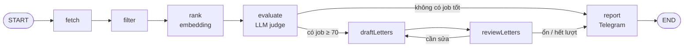

# Job Hunter Agent — LangGraph.js + Gemini (100% miễn phí)

Mỗi sáng 7h, agent tự:
1. Lấy job remote mới từ **Himalayas, Remotive, RemoteOK, Jobicy, We Work Remotely** (API/RSS public, miễn phí).
2. Lọc bằng luật (trùng lặp, cũ, sai stack, giới hạn quốc gia).
3. Xếp hạng theo **độ giống CV** bằng embedding (Gemini).
4. **LLM chấm điểm** từng job (0–100), kiểm tra có nhận người ở Việt Nam không, kỹ năng khớp/thiếu.
5. Nếu có job ≥ 70 điểm → **viết cover letter** → **một LLM khác review** → sửa lại nếu sai (tối đa 2 lần).
6. Gửi bản tóm tắt qua **Telegram**, lưu bản markdown, nhớ các job đã xem để không gửi trùng.

Chạy tự động mỗi ngày bằng **GitHub Actions** (miễn phí), không cần server.

---

## 0. Bức tranh tổng thể



| Khái niệm LangGraph | Trong dự án này |
|---|---|
| **State** | `src/graph/state.ts` — dữ liệu chạy qua mọi node (jobs, đánh giá, thư, log) |
| **Node** | Một hàm async nhận state, trả về phần state cần cập nhật (`src/graph/nodes/*`) |
| **Edge** | Thứ tự chạy cố định: fetch → filter → rank → evaluate |
| **Conditional edge** | Rẽ nhánh theo state: có job tốt không? thư đạt chưa? |
| **Cycle (vòng lặp)** | draft → review → draft… — đây là phần biến pipeline thành **agent** |
| **Reducer** | Trường `log` dùng reducer để **nối thêm** thay vì ghi đè |

**Vì sao không cho LLM làm hết?** Gọi LLM tốn quota và chậm. Thiết kế "phễu":
`~300 job` → filter luật (0 đồng) → `~40` → embedding (rẻ) → `12` → LLM chấm (đắt) → `≤3` viết thư.
Đây cũng là câu trả lời rất tốt khi phỏng vấn ("cost-aware agent design").

---

## 1. Tài nguyên miễn phí cần có

| Thứ | Dùng để | Lấy ở đâu |
|---|---|---|
| Gemini API key | LLM + embedding | https://aistudio.google.com/apikey |
| Telegram bot | Nhận thông báo | Chat với **@BotFather** trên Telegram |
| GitHub repo | Lưu code + chạy cron | github.com (repo **public** thì Actions miễn phí không giới hạn phút; private có quota phút miễn phí hằng tháng) |
| Node.js ≥ 22 | Chạy local | nodejs.org |

> Lưu ý free tier Gemini: Google có thể dùng dữ liệu gửi lên để cải thiện sản phẩm. Ở đây chỉ gửi CV công khai + job công khai nên không sao.
> Hạn mức free (RPM/RPD) xem tại https://aistudio.google.com/rate-limit — code đã có `sleep` giữa các lần gọi để không vượt.

---

## 2. Lộ trình 5 ngày

### Ngày 1 — Setup + lấy dữ liệu (không cần AI)
**Mục tiêu:** hiểu dữ liệu đầu vào.
```bash
npm install
cp .env.example .env        # điền GOOGLE_API_KEY
npm run test:sources        # in vài job mẫu từ mỗi nguồn (5 nguồn)
```
- Đọc `src/sources/*.ts`: mỗi nguồn trả JSON khác nhau → **chuẩn hoá** về kiểu `Job` chung (`src/types.ts`). Đây là bài học quan trọng nhất khi làm agent với dữ liệu thật.
- Mở `src/config.ts`, chỉnh `himalayasQueries`, `includeKeywords`, `excludeTitleKeywords` theo mục tiêu của bạn.
- Sửa `profile/cv.md` — **đây là "bộ não" của agent**, chỉ ghi điều đúng sự thật (cover letter sẽ dựa vào đây).

✅ Xong khi: `test:sources` ra job từ cả 5 nguồn.

### Ngày 2 — Filter + Embedding ranking
**Mục tiêu:** hiểu vì sao cần phễu và embedding.
- Đọc `src/graph/nodes/filter.ts`: dedupe theo `company|title`, loại job đã xem, quá cũ, sai keyword, giới hạn vùng (`locationLooksOk`).
- Đọc `src/graph/nodes/rank.ts` + `src/lib/embeddings.ts`:
  - CV được embed như **query** (`task: search result | query: ...`), job như **document** (`title: ... | text: ...`) — đúng format khuyến nghị cho `gemini-embedding-2`.
  - Gửi 20 job/lần (batch) để tiết kiệm request.
- Thử nghiệm: tạm sửa `src/index.ts` cho graph dừng sau `rank` (hoặc thêm `console.table(ranked)` trong node) để xem điểm similarity. Chỉnh `minSimilarity`/`topK`.

✅ Xong khi: top 12 job nhìn bằng mắt thấy hợp lý.

### Ngày 3 — LLM judge với structured output
**Mục tiêu:** bắt LLM trả về JSON đúng schema, không phải văn bản tự do.
- Đọc `src/graph/nodes/evaluate.ts`:
  - `EvalSchema` (zod) mô tả output: `fitScore`, `locationEligible`, `matchedSkills`, `missingSkills`, `summary`, `redFlags`.
  - `judgeModel.withStructuredOutput(EvalSchema)` → LangChain ép Gemini trả đúng schema, bạn nhận object có type sẵn.
  - `temperature: 0` để chấm điểm ổn định.
- Chạy thử không gửi Telegram:
  ```bash
  npm run dry
  ```
  Dry run **không** lưu `seen.json` nên chạy lại bao nhiêu lần cũng được.
- Chỉnh prompt `SYSTEM` nếu điểm quá dễ/quá khắt khe. Ghi lại 5–10 job bạn tự chấm tay rồi so với agent — đây là **evaluation** đơn giản.

✅ Xong khi: điểm của agent gần với cảm nhận của bạn.

### Ngày 4 — Vòng lặp draft ↔ review + Telegram
**Mục tiêu:** hiểu cycle và conditional edge — trái tim của LangGraph.
- Đọc `src/graph/nodes/letters.ts`:
  - `draftLetters`: viết thư cho tối đa 3 job tốt nhất; nếu đã có feedback thì viết lại theo feedback.
  - `reviewLetters`: model khác đóng vai reviewer, **bắt lỗi bịa thông tin** so với CV, độ dài, sáo rỗng.
  - `routeAfterReview`: còn thư chưa đạt và còn lượt → quay lại `draftLetters`; ngược lại → `report`.
- Đọc `src/graph/build.ts` để thấy cách nối node bằng `addEdge` / `addConditionalEdges`.
- Tạo Telegram bot:
  1. Telegram → @BotFather → `/newbot` → lấy **token**.
  2. Nhắn 1 tin bất kỳ cho bot của bạn.
  3. Mở `https://api.telegram.org/bot<TOKEN>/getUpdates` → tìm `"chat":{"id": ...}` → đó là **TELEGRAM_CHAT_ID**.
  4. Điền 2 giá trị vào `.env` rồi `npm start`.

✅ Xong khi: điện thoại nhận được digest có link job + bản nháp cover letter.

### Ngày 5 — Tự động hoá + hoàn thiện để khoe
1. Tạo repo GitHub, push code (**nhớ commit `package-lock.json`**, `.env` đã bị ignore).
2. Repo → Settings → Secrets and variables → Actions → thêm `GOOGLE_API_KEY`, `TELEGRAM_BOT_TOKEN`, `TELEGRAM_CHAT_ID`.
3. Tab Actions → "Daily job hunt" → **Run workflow** để test. Sau đó nó tự chạy 7h17 sáng mỗi ngày (giờ VN).
4. Workflow commit `data/seen.json` về repo để lần sau không gửi trùng; bản report tải được ở mục Artifacts.
5. Viết README tiếng Anh ngắn cho repo (sơ đồ mermaid ở trên + "Design decisions"), quay video demo 1 phút, thêm vào portfolio.

---

## 3. Cấu trúc thư mục
```
profile/cv.md                 # CV dạng text — nguồn sự thật duy nhất
src/config.ts                 # mọi tham số chỉnh được
src/types.ts                  # Job, Evaluation, Letter
src/sources/                  # himalayas, remotive, remoteok, jobicy, weworkremotely → Job[]
src/lib/embeddings.ts         # Gemini embedding (@google/genai)
src/lib/llm.ts                # ChatGoogle (LangChain) cho judge + writer
src/lib/telegram.ts           # gửi tin, tự chia nhỏ > 4096 ký tự
src/lib/store.ts              # data/seen.json (nhớ 60 ngày)
src/graph/state.ts            # StateSchema
src/graph/nodes/              # fetch, filter, rank, evaluate, letters, report
src/graph/build.ts            # nối graph
.github/workflows/job-hunter.yml
```

## 4. Bảng chỉnh nhanh (`src/config.ts`)
| Muốn… | Chỉnh |
|---|---|
| Ít job rác hơn | thêm từ vào `excludeTitleKeywords`, tăng `minSimilarity` |
| Tiết kiệm quota | giảm `topK`, `maxLetters` |
| Nhiều job hơn | thêm query vào `himalayasQueries`, tăng `maxAgeDays` |
| Khắt khe hơn | tăng `shortlistScore` lên 75–80 |
| Đổi model | biến môi trường `EVAL_MODEL`, `WRITER_MODEL` (xem model free hiện tại ở trang Models của Gemini API) |

## 5. Lỗi thường gặp
- **429 / quota exceeded**: tăng `evalDelayMs`, giảm `topK`, hoặc đổi sang model Flash-Lite.
- **Một nguồn trả 0 job**: API đổi format → chạy `npm run test:sources`, sửa file nguồn tương ứng. Các nguồn lỗi được bỏ qua, agent vẫn chạy tiếp.
- **Telegram 400 "can't parse entities"**: có ký tự HTML lạ — mọi text đã qua `escapeHtml`, nếu vẫn lỗi hãy log message ra xem.
- **Model not found**: Google đổi tên model → cập nhật `EVAL_MODEL` / `WRITER_MODEL`.
- **Lỗi kiểu (TypeScript) trong `state.ts`**: API `StateSchema` của LangGraph.js còn mới; nếu bản bạn cài khác, xem https://docs.langchain.com/oss/javascript/langgraph/graph-api và sửa cho khớp.

## 6. Tuân thủ điều khoản nguồn dữ liệu
- **Remotive**: tối đa ~4 lần/ngày, ≤ 2 request/phút, phải link về Remotive. (Agent gọi 1 lần/ngày.)
- **Himalayas**: có rate limit, phải link về Himalayas, không đẩy job sang trang khác.
- **RemoteOK**: phải ghi nguồn + link về.
- **Jobicy**: gọi tối đa 1 lần/giờ, phải ghi nguồn Jobicy và giữ nguyên link job của Jobicy. (Agent gọi 1 lần/ngày, mỗi geo trong `jobicyGeos` 1 request.)
- **We Work Remotely**: đọc RSS công khai, phải ghi nguồn + link về We Work Remotely. (Mỗi feed trong `wwrCategories` 1 request/ngày.)
- Agent chỉ dùng cho **cá nhân**, mọi job trong digest đều có link "Open on <nguồn>". Không public lại danh sách job.

## 7. Nâng cấp tiếp (khi đã chạy ổn)
1. **Human-in-the-loop**: thêm nút Telegram "Đánh dấu đã nộp / bỏ qua" → lưu lại → dùng làm dữ liệu chỉnh prompt.
2. **Theo dõi trạng thái ứng tuyển**: ghi vào Google Sheets (API miễn phí) hoặc Supabase free.
3. **LangSmith** (có gói free) để xem trace từng node, thời gian, token.
4. **Checkpointer** (`MemorySaver` / SQLite) để graph có thể dừng chờ bạn duyệt rồi chạy tiếp.
5. **Tool-calling agent**: cho LLM tự quyết định có cần mở trang công ty để đọc thêm trước khi chấm điểm.

## 8. Kể về dự án khi phỏng vấn (tiếng Anh)
> "I built a LangGraph.js agent that runs daily on GitHub Actions. It pulls remote jobs from three public APIs, filters them with cheap rules, ranks them against my CV using Gemini embeddings, and only sends the top 12 to an LLM judge with structured output. For strong matches it drafts cover letters, and a separate reviewer step checks them against my CV to block hallucinated claims, looping up to two revisions. Results go to Telegram. The whole thing runs on free tiers."
